# Site: short-screen layout directions (LEAD-04, proposal)

Status: **proposal for the PO, nothing built.** Owner: lead. Date: 2026-11-12.

PO request: "the design for small devices should be different than the one for devices with long
screens". Today one phone layout scales for every height: the scroll-story tracks `#paper`, `#notes`
and `#day` put the same elements on screen (nav, step pill, headline, subtitle, stage, button, a bubble
row, two mascots) and shrink the stage to whatever height is left.

## Evidence (current site, after the #345 / #346 / #347 fixes on this branch)

Chromium, DPR 1, scrolled to a point of each track. Files in [site-short-screen/](site-short-screen/).

| Track, point | 320x568 (iPhone SE 1st) | 375x667 (iPhone SE 3rd, REL-B) | 402x874 (iPhone Pro) |
|---|---|---|---|
| `#paper` 40% | 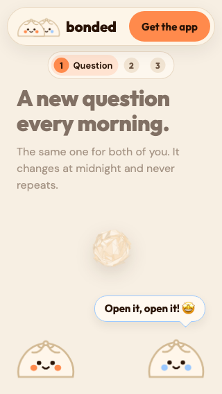 | 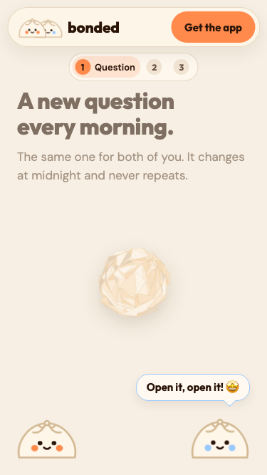 | 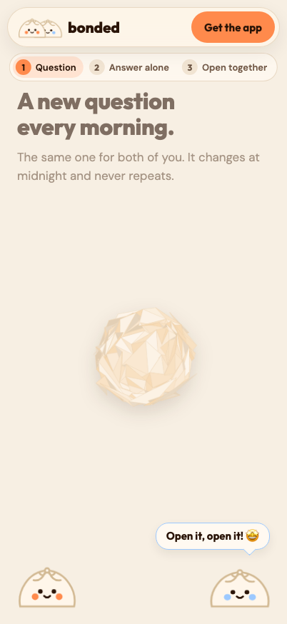 |
| `#notes` 50% | 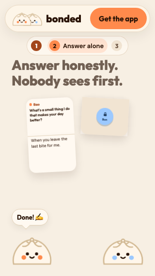 | 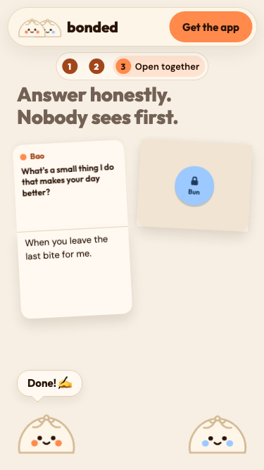 | 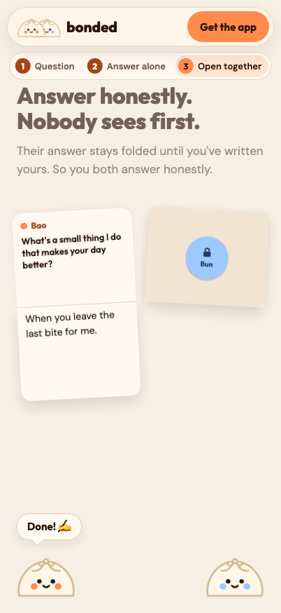 |
| `#notes` 100% | 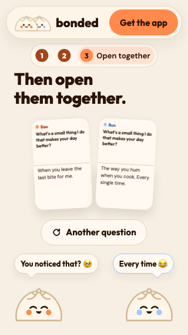 | 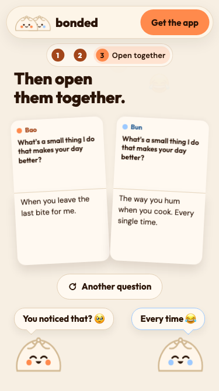 | 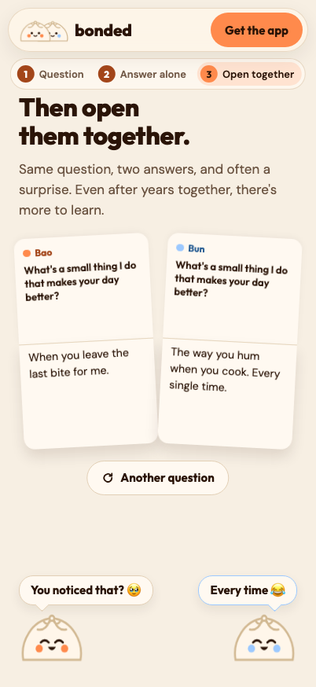 |
| `#day` 50% | 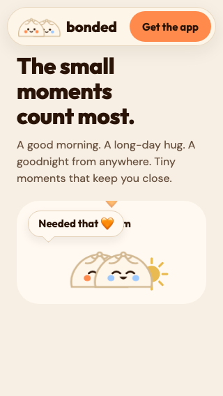 | 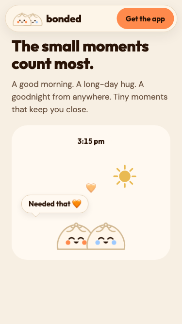 | 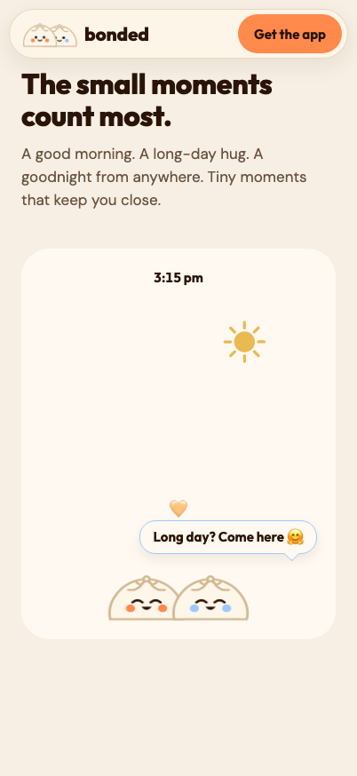 |

What the screenshots show:
- **402x874 works.** The notes are large, the subtitle shows, there is air between the button and the
  bubbles. Keep it.
- **On short screens the stage loses, not the chrome.** At 320x568 nine things share 568px: nav, step
  pill, a two-line headline, the notes, the button, two bubbles, two mascots. The fixed parts (nav 66,
  pill 44, bubble row + mascots about 190, button 72) take about 370px, so the notes get what is left:
  the note pair is 206x152px and the answer text renders at 8.2px (13.0px at 375x667, 14.1px at
  402x874, measured). The answer is the smallest text on the page, although it is the point of the
  section.
- **The subtitle is hidden** on `#notes` below 700px tall (`display:none`), so "Then open them together."
  loses its explanation exactly on the phones where the story is hardest to follow.
- **The paper card is squeezed** at 320x568: the question wraps to five lines in a narrow card.
- **`#day`**: the sky card is about 150px tall at 320x568 and the "Needed that" bubble covers the time
  label; below the card there is unused space because the frame is sized for the tall layout.

## The rule both directions share

Two layouts, chosen by the frame's real height, not the device name:

- **Short:** phone width (`max-width:959px`) and frame height `<= 700px`. Covers 320x568, 360x640,
  Galaxy S9+ 320x658, iPhone 13 in-browser 390x664, iPhone SE 3rd 375x667.
- **Tall:** everything else, the current layout unchanged (402x874, Pixel 7 412x839, Galaxy S8 360x740,
  iPad, desktop).

Implement it as a size container query on the sticky frame, not a viewport media query:
`.frame{container:frame/size}` (the frame is `height:100svh`), then
`@container frame (max-height:700px) and (max-width:959px){...}`. Reason: `100svh` is the height with the
browser bars showing, so the layout does not flip while the user scrolls and Safari's or Chrome's bars
collapse. A plain `@media (max-height:700px)` follows the ICB, which also uses the small viewport in
current Safari and Chrome, so it is an acceptable fallback, but the container query keeps the rule next
to the element whose height actually matters. The 701-799px band stays on the tall layout (it passes
QA-47 today).

QA-47's `qa/web` suite already runs both sides of the line (568, 640, 658, 664, 667 vs 740, 839, 874), so
either direction ships with the existing invariants plus the new per-direction checks below.

## Direction A: Spotlight (one focus element per step)

On short screens each step shows one thing at a time; the scroll scrubs between beats instead of
fitting every element at once.

| Track | Short layout |
|---|---|
| `#paper` | The question card gets the stage alone at full width (the question fits in 3 lines). Mascots shrink to 40px heads peeking from the bottom corners; their bubbles become one centred caption line under the card, one at a time. |
| `#notes` | One note at a time, full width: Bao's note, then a horizontal slide to Bun's (locked, then written). At "Open together" both notes fan in, overlapping by about a third, then settle side by side at the end so the reveal is still a pair. Reactions ("You noticed that?", "Every time") appear as small chips under the notes, not mascot bubbles. Subtitle comes back, clamped to two lines. |
| `#day` | The sky card takes the whole stage (about 300px at 568 tall); the morning-to-night bubbles move inside the card as short chat lines, so nothing covers the time label. |
| Chrome | Step pill becomes three dots inside the nav row; the nav keeps its height. |

- **Effort:** L, about 2-3 days. New beat timings per track in the scroll script, a second notes
  choreography, new tests (one-focus invariant, notes never both half-visible except during the fan).
- **Risks:** the "two of you, side by side" picture is the product's whole idea, and the spotlight hides
  it for most of `#notes`. More JS and more states that can freeze mid-scroll (the frozen-opacity bug
  class). Two designs of the same story to keep in sync whenever copy changes.

## Direction B: Compact duet (recommended)

Keep every beat and the side-by-side pair; take the height back from the chrome and the bubble row.

| Track | Short layout |
|---|---|
| All tracks | Mascots 72 to 52px. Speech bubbles sit **beside** the speaking mascot's head (tail pointing sideways) instead of in a row above them, which removes the separate bubble row (about 110px). When both mascots talk at once (the reactions at the end of `#notes`) the bubbles stack one above the other on their own side. |
| Chrome | The fixed step pill becomes a slim three-dot rail inside the nav bar, between the wordmark and "Get the app" (frees about 44px and removes the #347 class of overlap for good). |
| `#paper` | The freed height goes to the card: it can be wider, so the question keeps three lines. |
| `#notes` | Notes stay side by side and get about 150px more height, so the answer text returns to at least 13px (8.2px today at 320x568). The subtitle comes back, one or two lines. "Another question" stays under the notes. |
| `#day` | Sky card grows into the freed space; the bubbles hang off the mascots, outside the card's time label. |

- **Effort:** M, about 1 day. Mostly CSS inside the container query, plus a sideways-tail variant of
  `.bubble` and the dot rail (the step state already exists in JS). QA-47 rules keep working; add one
  check: note answer font-size >= 13px on short profiles.
- **Risks:** horizontal room at 320px: a bubble beside a 52px mascot has about 200px, so the longest
  lines ("Something came for us", "Long day? Come here") wrap to two lines; copy may need a shorter
  phone variant (PO owns copy). The dot rail is less explicit than "Question / Answer alone / Open
  together"; the headline already names the step, so the labels are not lost.

## Recommendation

**Direction B.** It answers the PO's point (short phones get their own layout, not a squeezed tall one),
keeps the pair-on-screen metaphor that the product is built on, is mostly CSS behind one container
query, and the tall layout stays byte-for-byte the same. Keep A's single-note slide in reserve if the
notes still read too small at 320x568 after B.

Design-judgement note: drafted with the Impeccable skill as a planning-only pass from the incumbent
site (no PRODUCT.md or DESIGN.md exists for `web/`); the PO's review of this file stands in for
Impeccable's interview step.
